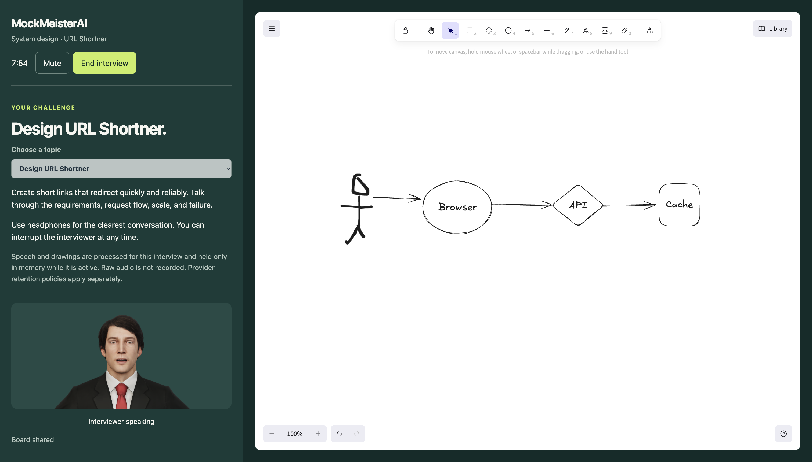
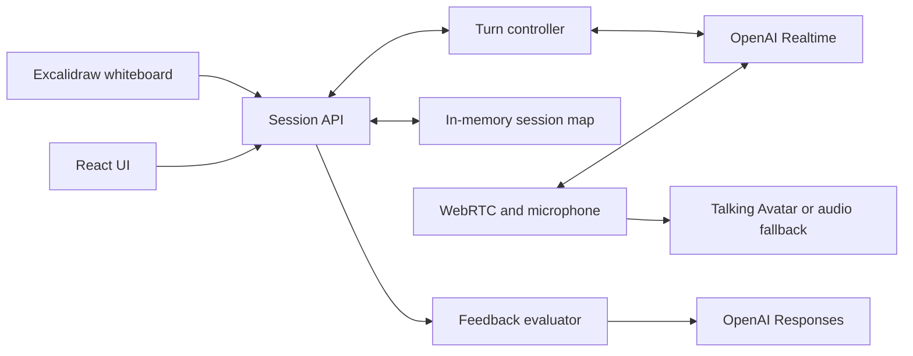

# MockMeister



A spoken system design interview with a browser-rendered 3D interviewer.
Choose from five ten-minute system-design discussions: URL Shortner, WhatsApp,
ChatGPT, Claude Code, or a scalable RAG system.

It uses OpenAI Realtime WebRTC, server-side turn control, captions, an
Excalidraw capture sent directly to the active interviewer, and final
evidence-based feedback. Diagram evidence lives only for the active interview;
feedback is based on the finalized candidate transcript.

## Deliberate scope

This is a portfolio-scale, real-time system—not a claim of a fully public,
commercial service. The implementation focuses on the hard core of the product:
low-latency voice interaction, interruption-safe response scheduling,
whiteboard-aware follow-ups, server-owned provider credentials, and
evidence-grounded final feedback.

Several familiar production components are intentionally absent: accounts,
durable storage, Redis, queues, microservices, Kubernetes, a custom canvas,
and an agent-orchestration framework. For a two-session portfolio demo, they
would add operational surface area without improving the interview experience.
In-memory sessions, one Node process, Excalidraw, and deterministic TypeScript
control flow keep the system small enough to explain and test.

For a public product, the natural next steps are durable reports and board
evidence, admission/rate limits, cost controls, background evaluation jobs,
object storage, observability, and horizontal session routing. They are known
trade-offs, not omissions disguised as features.

## Run locally

Requires Node.js 24+ and an OpenAI project key with Realtime access.
No database is required.

```powershell
npm ci
Copy-Item .env.example .env
# Set OPENAI_API_KEY privately in .env.
npm run dev
```

Open http://localhost:3000 with a current desktop browser and headphones.
Start requests microphone access; no camera or account is required.
Vite updates client files during development. Restart the server after
changing server code or environment variables.

```powershell
npm test
npm run typecheck
npm run build
npm start
```

`npm start` serves the built client and API from the same Node process.

## Configuration

| Variable | Purpose |
| --- | --- |
| `OPENAI_API_KEY` | Server-only project key; never prefix it with `VITE_` |
| `REALTIME_MODEL` | Defaults to `gpt-realtime-2.1-mini` |
| `PORT` | Defaults to `3000` |
| `PUBLIC_ORIGIN` | Exact browser origin, normally `http://localhost:3000` |
| `DEMO_ENABLED` | Must be `true` to admit interviews |

`.env` is ignored. Keep keys and session handles out of commits and screenshots.

## Voice and resource ownership

The browser sends its SDP offer to Express. The server creates the Realtime
call and attaches an authenticated sideband; the browser receives only the
SDP answer and an anonymous session handle. Microphone and generated audio
travel directly over WebRTC.

Server VAD commits candidate turns, while ordinary TypeScript schedules
responses. Generation and playback completion are tracked separately.
Interruption cancels generation and clears provider audio; the browser
detaches the avatar stream to discard its additional 150 ms playback buffer.
The next valid output event resumes playback. If the renderer or lip-sync
model fails, the same stream moves to a single ordinary audio element.
That transition happens once. Autoplay denial offers an explicit Enable sound
action; other plain-audio errors end the interview. There is no model switching,
automatic call reconnect, or chain of alternate implementations.

End stops local tracks, closes the peer and data channel, disposes playback,
and requests provider REST hangup. Setup errors, missed heartbeats, the
ten-minute deadline, and shutdown also terminate calls. Failed hangup
confirmation is reported explicitly. Transcripts exist only in process memory;
application records are not durable. Assistant output
is conservatively not certified as heard evidence until playback receipts
are implemented for evaluation.

The character, lip-sync model, and notices are served locally. See
[avatar provenance and licenses](public/avatars/NOTICE.md).

## Verification and limits

Automated checks cover the main lifecycle and turn-control behavior, but a
successful build does not prove a real spoken exchange or lip sync. The current
two-call cap and ten-minute deadline do not make a public paid endpoint
abuse-proof.

# MockMeisterAI — High-Level Design

MockMeisterAI is a portfolio system-design interview simulator. A visitor selects one of five interview topics, talks to an AI interviewer, uses a whiteboard, and receives concise evidence-grounded feedback after ending the interview.

This document describes the application as built, rather than a roadmap.

## Product scope

The five supported topics are URL shortener, WhatsApp, ChatGPT, Claude Code, and scalable RAG. Each topic supplies a distinct opening question and interview focus. A session lasts at most ten minutes, may be ended earlier, and requires microphone access. The browser never receives the OpenAI API key.

The application intentionally has no account system, database, durable reports, background job system, or custom drawing editor. Sessions, transcripts, whiteboard snapshots, and feedback are process memory only. They disappear when the session expires, the process restarts, or completed-session cleanup runs.

## Architecture



The browser negotiates WebRTC through the server, then sends microphone audio directly to OpenAI Realtime. The Node server owns the API key, authenticated Realtime sideband connection, lifecycle timers, and response scheduling. The browser receives remote audio and gives it to the 3D avatar; if avatar rendering fails, one ordinary audio element plays the same stream.

The whiteboard waits for a short idle period before it captures a PNG and Excalidraw element metadata. The server validates the image, sends it to the active Realtime conversation as untrusted diagram evidence, then queues one focused question. Text written on the board is never treated as instructions.

On End, the server closes the Realtime call and sends finalized candidate transcript turns to a separate text-model evaluation. Structured feedback can cite only those candidate turns. Board images guide the live discussion but are not used in the final report.

## Core decisions and trade-offs

| Decision | Why | Trade-off |
| --- | --- | --- |
| One Node process and in-memory sessions | Smallest architecture for a portfolio demo; session coordination is straightforward. | No recovery, horizontal scaling, or report history. |
| Browser WebRTC with server sideband | Low-latency audio while keeping the API key server-side and allowing server control. | Requires a long-running stateful server, not a static host. |
| Deterministic TypeScript turn controller | Makes interruption, response ordering, and cleanup testable. | Less flexible than delegating orchestration to another model. |
| Excalidraw instead of a custom canvas | Provides a capable familiar whiteboard with minimal application code. | Adds a large client bundle. |
| Separate evaluator after the call | Feedback does not delay the spoken conversation and citations are validated. | Feedback is unavailable if that final model call fails. |
| Anonymous session handle | Scopes access to a session without building authentication. | It is not user identity or a public-service authorization layer. |

## Safety and lifecycle controls

- Session creation validates the selected topic, origin, and request payload.
- A random session handle is required for every session-specific route; only its SHA-256 hash is retained server-side.
- The server admits at most two non-terminal interviews, limits a session to ten minutes, detects missed heartbeats, and closes provider calls on failure or shutdown.
- Board uploads have JSON and image-size limits, PNG validation, version conflict checks, and duplicate detection.
- The OpenAI key remains server-only; feedback calls use `store: false`.

These controls make the demo safer to operate but do not make it safe as an unrestricted public paid endpoint. A public launch needs admission/rate limits appropriate to the chosen host and budget.

## Deployment shape

Build with `npm run build` and run with `npm start`. Configure `OPENAI_API_KEY`, `REALTIME_MODEL`, `WORKER_MODEL`, `PORT`, `PUBLIC_ORIGIN`, and `DEMO_ENABLED` in the host environment. Use one HTTPS origin for page and API.

The current server deliberately listens on loopback, which is suitable for a same-host reverse proxy. A container/PaaS deployment that expects an externally bound application must change that binding. `PUBLIC_ORIGIN` must exactly match the final browser origin.

## Interview discussion prompts

Useful discussion points are why the sideband is server-owned, how the turn controller avoids overlapping responses, why session handles are hashed, how to make sessions durable, how to add abuse controls, and how to make final feedback incorporate whiteboard evidence. Those are natural next-step designs, not features this portfolio version claims to implement.

# MockMeisterAI — Low-Level Design

Read [HLD](HLD.md) for system boundaries and trade-offs. This document records the implemented contracts.

## Code ownership

```text
client/
  App.tsx          page state, topic picker, interview and feedback UI
  voice.ts         WebRTC, microphone, client session lifecycle and captions
  playback.ts      avatar/audio ownership, interruption and fallback
  Whiteboard.tsx   Excalidraw capture and debounced board uploads
server/
  index.ts         environment, HTTP listener, dev/production asset serving
  app.ts           API routes, in-memory sessions, validation and cleanup
  realtime.ts      OpenAI Realtime call and authenticated sideband
  evaluation.ts    structured final feedback and citation validation
  challenge.ts     topic-specific interviewer instructions
shared/
  challenges.ts    allowed topic IDs and topic content
  voice.ts         turn log and response scheduling
  feedback.ts      feedback contract
```

## Session state

```ts
type Status = 'starting' | 'active' | 'finalizing' | 'completed' | 'failed';
```

A `POST /api/sessions` request creates a `starting` session and returns a UUID plus a random handle. The raw handle remains only in browser memory; the server stores its hash. A successful WebRTC offer/answer and heartbeat moves the session to `active` and starts the ten-minute deadline.

`end()` is idempotent: it changes state to `finalizing`, stops the turn controller, aborts the Realtime operation, closes the provider call, evaluates finalized candidate turns, and marks the session `completed` (or `failed` when an error message explains termination). A one-second sweep terminates expired or abandoned sessions and removes terminal sessions after inactivity.

## API

| Route | Contract |
| --- | --- |
| `GET /api/health` | Returns `{ ok, configured }`; no secret is exposed. |
| `POST /api/sessions` | Accepts `{ headset?, challengeId? }`; validates the allowlisted topic and returns session ID, handle, challenge, and 600-second maximum. |
| `POST /api/sessions/:id/voice` | Requires session handle and an audio SDP offer; returns the Realtime SDP answer once. |
| `POST /api/sessions/:id/heartbeat` | Requires `{ voiceConnected }`; establishes liveness and returns a snapshot. |
| `GET /api/sessions/:id` | Returns the current snapshot. |
| `GET /api/sessions/:id/events` | Opens an SSE stream with an initial snapshot and keepalives. |
| `POST /api/sessions/:id/board` | Accepts a versioned Excalidraw scene and PNG, validates it, and returns an acknowledgement or conflict. |
| `POST /api/sessions/:id/end` | Idempotently closes the interview and returns its snapshot. |

All session routes require `X-Interview-Session`. API mutations require an exact `Origin` matching `PUBLIC_ORIGIN`; API responses are `no-store`.

## Voice and response sequencing

The client gets microphone audio with echo cancellation, noise suppression, and automatic gain control, creates an SDP offer, then attaches the remote audio track to the avatar playback owner. A Realtime data channel supplies captions to the browser. The server separately attaches an authenticated WebSocket sideband to receive authoritative events and send controls.

`createTurnController` accepts provider events, keeps finalized turns, ignores filler/one-word candidate transcript turns, and schedules a single next response only after the previous output is safe to replace. Candidate speech that remains continuous long enough interrupts active interviewer audio. Playback tracks model audio separately from avatar playback so stale buffered audio does not resume after interruption.

## Board handling

The client waits four seconds after the last meaningful Excalidraw change and sends at most one capture every five seconds. The server accepts up to 500 elements and a 1.4 MB base64 field; decoded images must be valid PNGs up to 1600×1600 and at most 1 MB. Scene versioning and a fingerprint make retries safe and reject conflicting updates.

When a non-empty board is accepted, the server explicitly frames it as untrusted evidence, sends the image to the active Realtime call, and asks exactly one short question about a visible component or connection.

## Feedback contract

At interview end, the evaluator receives only finalized non-empty candidate turns for the selected topic. It produces:

```ts
type Feedback = {
  strengths: { text: string; citations: string[] }[];
  improvements: { text: string; citations: string[] }[];
  limitations: string[];
};
```

Zod validates the response. Every citation must refer to an actual candidate turn from that session; otherwise feedback is rejected. Evaluation failure preserves the transcript snapshot and returns a clear error instead of fabricated feedback.

## Limits and known boundaries

- 2 simultaneous non-terminal sessions
- 30-second setup timeout; 45-second missing-heartbeat timeout
- 10-minute active-session deadline
- in-memory state only; process restart loses active and completed sessions
- no accounts, persistence, cross-process coordination, or public rate/admission limits

The test suite covers session isolation, setup/end races, board-to-Realtime delivery, turn scheduling, transcript filtering, feedback citations, and playback fallback. Browser microphone, WebRTC networking, audible interruption, and avatar lip sync remain integration checks on the target host and device.
