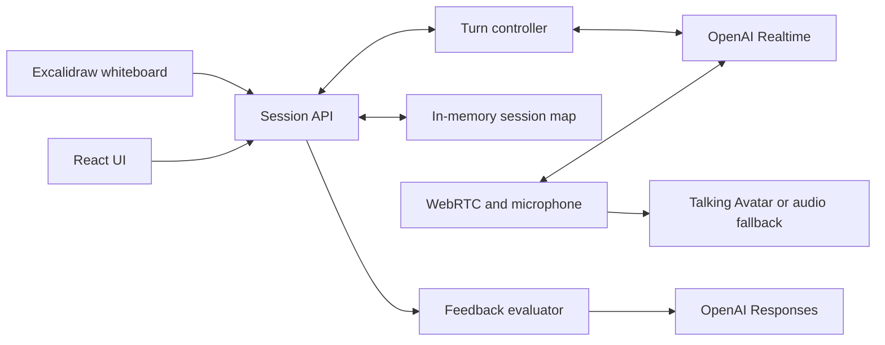

# MockMeisterAI — High-Level Design

MockMeisterAI is a portfolio system-design interview simulator. A visitor selects one of five interview topics, talks to an AI interviewer, uses a whiteboard, and receives concise evidence-grounded feedback after ending the interview.

This document describes the application as built, rather than a roadmap.

## Product scope

The five supported topics are URL shortener, WhatsApp, ChatGPT, Claude Code, and scalable RAG. Each topic supplies a distinct opening question and interview focus. A session lasts at most ten minutes, may be ended earlier, and requires microphone access. The browser never receives the OpenAI API key.

The application intentionally has no account system, database, durable reports, background job system, or custom drawing editor. Sessions, transcripts, whiteboard snapshots, and feedback are process memory only. They disappear when the session expires, the process restarts, or completed-session cleanup runs.

## Architecture

The browser negotiates WebRTC through the server, then sends microphone audio directly to OpenAI Realtime. The Node server owns the API key, authenticated Realtime sideband connection, lifecycle timers, and response scheduling. The browser receives remote audio and gives it to the 3D avatar; if avatar rendering fails, one ordinary audio element plays the same stream.

The whiteboard waits for a short idle period before it captures a PNG and Excalidraw element metadata. The server validates the image, sends it to the active Realtime conversation as untrusted diagram evidence, then queues one focused question. Text written on the board is never treated as instructions.

On End, the server closes the Realtime call and sends finalized candidate transcript turns to a separate text-model evaluation. Structured feedback can cite only those candidate turns. Board images guide the live discussion but are not used in the final report.

## Core decisions and trade-offs

| Decision | Why | Trade-off |
| --- | --- | --- |
| One Node process and in-memory sessions | Smallest architecture for a portfolio demo; session coordination is straightforward. | No recovery, horizontal scaling, or report history. |
| Browser WebRTC with server sideband | Low-latency audio while keeping the API key server-side and allowing server control. | Requires a long-running stateful server, not a static host. |
| Deterministic TypeScript turn controller | Makes interruption, response ordering, and cleanup testable. | Less flexible than delegating orchestration to another model. |
| Excalidraw instead of a custom canvas | Provides a capable familiar whiteboard with minimal application code. | Adds a large client bundle. |
| Separate evaluator after the call | Feedback does not delay the spoken conversation and citations are validated. | Feedback is unavailable if that final model call fails. |
| Anonymous session handle | Scopes access to a session without building authentication. | It is not user identity or a public-service authorization layer. |

## Safety and lifecycle controls

- Session creation validates the selected topic, origin, and request payload.
- A random session handle is required for every session-specific route; only its SHA-256 hash is retained server-side.
- The server admits at most two non-terminal interviews, limits a session to ten minutes, detects missed heartbeats, and closes provider calls on failure or shutdown.
- Board uploads have JSON and image-size limits, PNG validation, version conflict checks, and duplicate detection.
- The OpenAI key remains server-only; feedback calls use `store: false`.

These controls make the demo safer to operate but do not make it safe as an unrestricted public paid endpoint. A public launch needs admission/rate limits appropriate to the chosen host and budget.

## Deployment shape

Build with `npm run build` and run with `npm start`. Configure `OPENAI_API_KEY`, `REALTIME_MODEL`, `WORKER_MODEL`, `PORT`, `PUBLIC_ORIGIN`, and `DEMO_ENABLED` in the host environment. Use one HTTPS origin for page and API.

The current server deliberately listens on loopback, which is suitable for a same-host reverse proxy. A container/PaaS deployment that expects an externally bound application must change that binding. `PUBLIC_ORIGIN` must exactly match the final browser origin.

## Interview discussion prompts

Useful discussion points are why the sideband is server-owned, how the turn controller avoids overlapping responses, why session handles are hashed, how to make sessions durable, how to add abuse controls, and how to make final feedback incorporate whiteboard evidence. Those are natural next-step designs, not features this portfolio version claims to implement.
