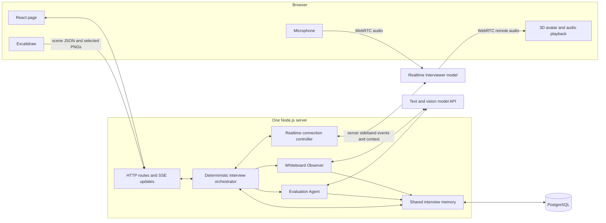

# MockMeister — High-Level Design

Planning baseline: 21 October 2026; dependency/model choices updated 22 October 2026. Implementation details: [LLD](LLD.md). Build order: [implementation plan](IMPLEMENTATION_PLAN.md).

## 1. What we are building

A hiring manager opens **MockMeister**, a public portfolio demo, clicks **Start interview**, and has a short spoken system design interview while drawing in Excalidraw. A small 3D interviewer speaks with lip sync. It notices meaningful diagram changes, remembers spoken reasoning even when nothing is drawn, and produces feedback supported by the interview's evidence.

The engineering demonstration is consistent shared memory across voice, drawings, and asynchronous agents. The avatar makes that experience tangible; Excalidraw supplies the drawing interface.

### First complete version

- One fixed challenge: **Design a URL shortener**. The interviewer answers clarification questions using a fixed challenge brief.
- One ten-minute interview, with an End button for a shorter visit.
- Spoken questions, candidate speech, follow-up questions, hints when requested, and interruptions.
- Excalidraw's normal drawing tools and controls, with selected scene exports analyzed in the background.
- One browser-rendered 3D avatar driven by the interviewer's actual audio.
- Persistent transcript, diagram observations, decisions, unresolved questions, and rubric evidence.
- A plain final report with strengths, gaps, suggested improvements, and evidence references.

### Explicitly outside this build

No signup, login, OAuth, user profiles, payments, resume uploads, scheduling, interview marketplace, admin dashboard, multiplayer drawing, custom canvas, custom avatar editor, question bank, mobile-first design, or elaborate landing page. No vector database, Redis, message broker, microservices, Kubernetes, agent framework, or extra LLM orchestrator.

No live-session recovery after a full page refresh or server restart. Completed and interrupted session records remain available in storage; recovering an active voice connection is separate work.

## 2. The visitor's interface

```text
┌───────────────────────────────────────────────────────────────┐
│ MockMeister · URL Shortener   08:42       [Mute] [End interview]│
├───────────────────────────────────────────┬───────────────────┤
│                                           │ Small 3D avatar   │
│                                           │                   │
│          Excalidraw                       │ Listening…        │
│          existing toolbar and canvas      │ Latest captions   │
│                                           │                   │
└───────────────────────────────────────────┴───────────────────┘
```

Before starting: challenge summary, Start button, and one sentence explaining that speech transcripts and drawings are processed by AI and retained for 24 hours. Microphone permission follows the click. No webcam or screen-sharing permission is required: the app exports its own drawing.

After ending: replace the small side panel with feedback or show a plain full-width report. Include evidence links that open the cited transcript turn or diagram observation. No chart, animated score gauge, or custom design system is needed. Use ordinary accessible buttons, visible status/error text, and readable captions.

## 3. Architecture



HTTP carries commands and board snapshots; one Server-Sent Events connection carries application status/report notifications to the page. The provider's browser data channel supplies immediate captions. A provider sideband connection gives the server authoritative conversation events and a way to supply shared memory. These connections are transports, not additional services.

### Three model roles, one code orchestrator

| Component | Owns | Must not do |
|---|---|---|
| Realtime Interviewer | Listening, speaking, natural follow-up questions, conversational context | Treat drawings as certain or score its own answers as candidate evidence |
| Whiteboard Observer | Interpreting selected diagram frames, components, connections, changes, uncertainty | Decide the candidate's intent from appearance alone or speak to the visitor |
| Evaluation Agent | Extracting durable conversational decisions at checkpoints; assessing evidence; final feedback | Invent missing answers or overwrite the current diagram |
| Orchestrator, ordinary code | Session lifecycle, scheduling, deadlines, event ordering, stale-result checks, context delivery | Ask another model to make routine control-flow decisions |

The observer and evaluator are prompt-driven functions in the same server process. They have separate inputs and output contracts; they are not autonomous services chatting indefinitely. They may share the same underlying text/vision model.

## 4. Stack decisions

| Area | Choice | Reason |
|---|---|---|
| Browser | React, TypeScript, Vite | Straightforward client rendering for canvas, audio, and 3D |
| Drawing | `@excalidraw/excalidraw` and its existing CSS | Reuse the actual editor; no drawing UI implementation |
| Avatar | `@interviewflowai/talking-avatar` plus its `three` peer dependency | The selected open-source integration |
| Server | Node.js, TypeScript, Express; `ws` for provider sideband | One long-running process for HTTP, SSE, timers, and background requests |
| Models | OpenAI `gpt-realtime-2.1-mini` for voice; `gpt-6-luna` through Responses for observer/evaluator | One AI provider; start with cheaper models and measure their quality |
| Persistence | PostgreSQL, `pg`, SQL migration files | Store events, current state, and small frame evidence in one database |
| Contracts | Zod schemas shared by server and browser where relevant | Validate incoming input and model output using the same definitions |
| Checks | Node test runner for server logic; manual browser/audio acceptance checks | Test ordering and memory behavior without building a test platform |

These are proposed implementation choices, not requirements hidden in the original chat. Keep one root package and one TypeScript codebase with `client/`, `server/`, and `shared/` folders. Avoid a monorepo framework.

At implementation time, pin mutually compatible package versions in the lockfile. Set `REALTIME_MODEL=gpt-realtime-2.1-mini` and `WORKER_MODEL=gpt-6-luna`. Validate account access, diagram understanding, and evidence-grounded evaluation in the integration milestones before spending on larger models. Model IDs belong in these two server environment variables; no provider abstraction or automatic model router is needed. The official pages document the lower-cost voice model and Luna's image input/structured output support: [Realtime Mini](https://developers.openai.com/api/docs/models/gpt-realtime-2.1-mini), [Luna](https://developers.openai.com/api/docs/models/gpt-6-luna).

### What remains a dependency

OpenAI is the only external AI API. This is not a dependency-free application: React/Excalidraw, the avatar SDK/Three.js, the server packages, and PostgreSQL remain open-source dependencies. Use native browser audio/WebRTC, Node's test runner and environment-file support, and SQL migrations; add no separate agent, speech, animation, ORM, test, or environment-loader framework.

Run PostgreSQL locally during development without Docker or a hosted database account. Production still needs a host for the app and PostgreSQL, either colocated or managed. Install-time package registries and asset downloads are distinct from runtime service dependencies. Serve the GLB, lip-sync model, and Excalidraw fonts from this application's origin so normal interviews do not depend on those vendors' CDNs. Confirm this with the browser Network panel during acceptance testing.

## 5. Shared memory is the center

| Layer | Stored information | Update trigger |
|---|---|---|
| Event log | Finalized speech turns, diagram submissions, worker results, phase/status changes, failures | Every meaningful accepted event |
| Current state | Latest scene version, accepted diagram interpretation, decisions, assumptions, hints, open questions, rubric coverage, current focus | Validated events and checkpoint results |
| Next-response context | Current phase and focus, relevant decisions, current diagram with freshness, unanswered questions | Built by code before a spoken response |

All three roles use the same session ID and evidence IDs. Distinguish **candidate-stated**, **visually observed**, and **model-inferred** information. Keep contradictory statements with their source; a later candidate correction can supersede an earlier decision without deleting history.

When drawing stops for five minutes, finalized speech still enters the event log. The live voice model retains its conversation, while the evaluator periodically updates structured conversational memory. Subsequent response context contains these decisions regardless of whether a new frame exists.

An absent cache-invalidation label means “not shown on this drawing,” not “the candidate has no invalidation strategy.” The evaluator must check spoken evidence before calling it a gap.

## 6. The main flows

**Start:** create an anonymous session, establish browser WebRTC through the backend's SDP endpoint, attach server observation/control, start the server deadline, and ask the first question. The backend keeps the provider API key.

**Talk:** audio travels directly between browser and voice provider. The server records finalized transcript events and provides the next bounded memory context. Worker calls never sit in the voice-response path.

**Draw:** export a stable scene after changes; send its native element metadata and PNG. The observer examines the latest useful frame asynchronously. Only a result matching the latest submitted scene version can become the current diagram interpretation. While it is catching up, the interviewer knows the previous interpretation is stale.

**Evaluate:** after three new candidate turns, or after 60 seconds with new transcript evidence, run a coalesced checkpoint. The evaluator updates decisions, open questions, hints, and rubric evidence. It does not speak or cause a new voice turn. Run final evaluation after the interview ends.

**End:** freeze input, settle in-flight transcript and final board work within a short bounded window, close voice resources, and evaluate the frozen evidence set. Show partial feedback with an explicit limitation if some final evidence is unavailable.

## 7. Avatar integration

The chosen project's open-source SDK runs in the browser. Its documented `attachStream(MediaStream)` accepts remote WebRTC audio and plays that audio with lip sync. Send the remote interviewer stream to it as the sole playback owner. This avoids a second voice or a second playback path. Its stream lip-sync delay defaults to 150 ms. The SDK and demo are distinct from the vendor's hosted realistic-avatar product. [SDK source](https://github.com/interviewflowai/talking-avatar), [API reference](https://talking-avatar.dev/open-source-talking-avatar-api).

Use one of the selected project's demo Microsoft Rocketbox avatars, served locally as `/avatars/interviewer.glb`, with its MIT notice. The repository provides the SDK and lip-sync model; do not assume installing its npm package also supplies a character GLB. Obtain the actual compatible demo asset and retain its upstream provenance/license. Bundle the package's `viseme-model.bin` through Vite's URL import and explicitly pass `modelUrl`, overriding the default jsDelivr download. Assets have not yet been downloaded into this repository. If 3D rendering fails, switch the same remote audio to a plain audio element and keep the interview running. Test interruption behavior with the SDK's playback delay; do not assume canceling model generation also drains audio already buffered in the browser.

## 8. Hosting and anonymous access

Deploy one always-on Node service serving the built React assets and API, plus PostgreSQL on the same host or a managed instance. Use HTTPS and same-origin routes. Avoid request-only serverless hosting for the live session controller. Local development uses Vite's API/SSE proxy and native PostgreSQL.

No accounts or login. Give the browser an unguessable per-interview handle in tab memory. That handle only accesses that interview; expose no public session listing and do not put it in analytics or URLs. This is a small request-scoping check, not an account system.

Because the demo funds real model calls, enforce ten-minute sessions, two simultaneous live sessions, a small daily start cap, and an operator-controlled start switch. Validate payload size and origin. These are a few server checks, not an auth product. Limits constrain use but do not make a public paid endpoint abuse-proof.

Retain application records for 24 hours, then delete them with a startup/periodic SQL cleanup. Do not record raw microphone audio or put transcript content in general application logs. The one-line notice must distinguish this application's retention from the model provider's own data policy.

## 9. How we know it works

The complete demo must show: a drawing-aware follow-up; a relevant follow-up after a long voice-only discussion; speech interruption; a stale observer result that cannot replace newer evidence; and final feedback that links to real candidate evidence.

Measure time from candidate speech end to first audible response, observer turnaround, dropped stale observations, worker failures, and provider-reported usage. Initial targets are under two seconds median voice response and under eight seconds median observation on the tested setup. These are acceptance targets to measure, not established performance claims.

Keep one small recorded fixture and compare a single-model transcript+frame evaluation with the specialized worker pipeline on the same evidence. Report findings and costs honestly; do not add a second runtime architecture or claim the multi-agent version is better without measuring it.

## 10. Verified integration references

Excalidraw exposes scene change callbacks and image export utilities, which support this capture design: [props](https://docs.excalidraw.com/docs/@excalidraw/excalidraw/api/props/), [exports](https://docs.excalidraw.com/docs/@excalidraw/excalidraw/api/utils/export).

OpenAI documents a backend-mediated WebRTC setup and a server sideband for receiving events and controlling the same session: [WebRTC](https://developers.openai.com/api/docs/guides/voice-webrtc?voice-api=realtime), [server controls, Realtime section](https://developers.openai.com/api/docs/guides/voice-server-controls?voice-api=realtime). Use the Realtime API examples consistently; do not mix their event names with the separate GPT-Live API examples on these pages.
